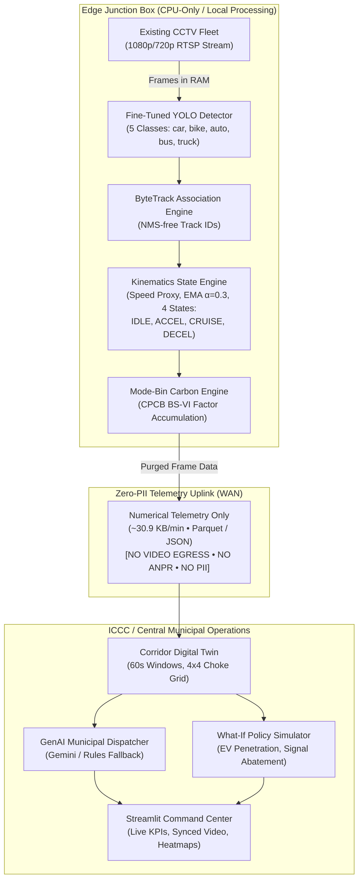

# CarbonTrack
### Real-Time Municipal Carbon Intelligence & GenAI Dispatcher Platform

[](https://www.python.org/downloads/)
[](https://pytorch.org/)
[]()
[]()
[]()

The **Eco-Kinetic Traffic Carbon Digital Twin** retrofits existing municipal CCTV traffic camera fleets into real-time carbon intelligence networks without installing new physical sensors or streaming high-bandwidth video over WAN. Operating strictly on edge CPUs, it extracts vehicle kinematics, calculates deterministic carbon emissions using official CPCB/ARAI BS-VI factors, simulates counterfactual abatement policies, and generates schema-constrained traffic signal directives via a GenAI municipal dispatcher.

---

## 1. System Architecture



---

## 2. Key Engineering Principles & Non-Negotiable Guardrails

1. **CPU-First Edge Execution:** Zero CUDA dependencies. All PyTorch and ONNX models run on standard multicore commodity x86/ARM CPUs.
2. **Deterministic Carbon Calculation:** The LLM **NEVER** computes emissions or fuel math. All tailpipe figures are calculated in Python from empirical `config/emission_factors.yaml`.
3. **Strict Privacy by Design:** Zero Personally Identifiable Information (PII). No Automatic Number Plate Recognition (ANPR), no facial recognition, and zero video transmission over the network.
4. **Resilient Dual-Mode Dispatch:** Signals are driven by schema-constrained LLM advisories with automatic deterministic fallback if the API times out (>8s) or is offline.

---

## 3. Quickstart & Installation

### Prerequisites
- Linux / macOS
- Python 3.10, 3.11, or 3.12
- Standard commodity CPU (no GPU required)

### Step 1: Clone and Set Up Virtual Environment
```bash
git clone https://github.com/your-org/eco-kinetic-twin.git
cd eco-kinetic-twin

# Create virtual environment
python3 -m venv .venv
source .venv/bin/activate

# Install CPU dependencies
pip install --upgrade pip
pip install -r requirements.txt
```

### Step 2: Configure Environment (Optional for LLM)
```bash
cp .env.example .env
# Edit .env and supply GEMINI_API_KEY (system automatically uses rules_fallback if unset)
```

### Step 3: Run Full Golden Test Suite
```bash
.venv/bin/pytest -q
# Expected: 54 passed in ~28s
```

### Step 4: Run Perception Pipeline on Real CCTV Video
```bash
# Process CCTV video to generate artifacts/telemetry.parquet
python scripts/run_pipeline.py --input assets_workspace/junction.mp4 --output-dir artifacts

# Or generate synthetic telemetry instantly via mock flag:
python scripts/run_pipeline.py --mock
```

### Step 5: Launch Streamlit Dashboard
```bash
streamlit run dashboard/app.py
```
Open `http://localhost:8501` in your browser. Use the left sidebar to navigate between:
1. **Junction Video Operations**: Continuous tracking overlay, 60s kinematic window, 4x4 spatial choke grid, What-If counterfactual policy simulation, and municipal directive stream.
2. **Image Intelligence**: Instantaneous single-frame photograph vehicle perception with bounding boxes, class distribution, and data exports.

### Step 5b: Traffic Image Intelligence (Single-Frame Analysis)

Users can analyze stationary intersection photographs without requiring the continuous video pipeline:
- **Workflow**:
  1. Select **Image Intelligence** in the sidebar.
  2. Upload any traffic photograph (`.jpg`, `.jpeg`, `.png`, or `.webp`, max 20 MB).
  3. Preview original photograph and select desired detection confidence threshold (default: `0.30`).
  4. Click **Process Image** to run CPU-only YOLO inference.
  5. Inspect annotated bounding boxes, vehicle counts, mean confidence, latency (ms), and class distribution chart.
  6. Download annotated images and detection ledgers as CSV or JSON.
- **Model Taxonomy & Class Support**:
  - Configured in `config/app.yaml` (`yolo26n.pt` on CPU). Dynamically resolves `model.names ∩ active_classes`.
  - Stock COCO weights support 4 vehicle classes: `car`, `motorcycle`, `bus`, and `truck`.
  - *Auto-Rickshaw Limitation Note:* Off-the-shelf COCO models lack a dedicated `auto_rickshaw` class. The UI transparently reports this constraint without inventing detections. When 5-class Indian taxonomy is required, fine-tuned weights (`models/finetuned/best.pt`) are available.
- **Strict Privacy & Input Security**:
  - 100% local CPU processing in volatile memory. No photographs or frames are transmitted to external services, commercial APIs, or LLMs.
  - Zero PII: Excludes facial recognition and license plate recognition (ANPR).
- **Physical Boundaries (No Fabricated Kinematics or Emissions)**:
  - Single still images represent instantaneous snapshots. Speed, acceleration, stop events, and cumulative tailpipe emissions are **never fabricated from a static photograph**. Dynamic emissions are exclusively modeled in the video pipeline.

### Step 6: Launch Next.js ATCS Municipal Operations Center
```bash
cd dashboard-web
npm install
npm run dev
```
Open `http://localhost:3000` in your browser to interact with the modern Next.js / TypeScript / Tailwind CSS control center, including:
- **`MunicipalDispatchFeed.tsx`**: Chronological advisory feed with `Mode: Gemini 1.5 Flash` vs `Mode: Rules-Engine Fallback` high-contrast pill badges, urgency indicators, confidence gauge, and $\le 300\text{ chars}$ municipal rationale.
- **Action Chips**: Concrete signals for `extend_green`, `green_wave_priority`, `heavy_vehicle_restriction`, and `no_action`.
- **Deterministic CO2 Savings Badge**: Highlighting `⚡ 1,246.7 g CO2 Avoided` with tooltip *"Computed via CPCB mode-bin engine, never LLM hallucination"*.
- **One-Click Dispatch**: Direct push to ATCS/SCATS with simulated transmission ping, plus multi-dimensional status and mode filters with full-text search.

### Step 7: Swapping Junction Video (At Will)

You can swap out the junction video at any time using either the UI or the terminal:

**Method A: In the Web UI**
1. Click the **"↑ Swap Video"** button in the CCTV player top bar.
2. Pick any `.mp4`, `.webm`, `.mkv`, or `.mov` from your computer.
3. The video instantly plays with synchronized telemetry overlays and is persisted to the edge server.
4. Click **"Reset"** to return to the default feed.

**Method B: Via CLI Command**
```bash
python scripts/swap_video.py /path/to/any_video.mp4
```
*(Automatically transcodes to 720p H.264 `+faststart`, updates web public assets, and re-renders the perception overlay)*.

---

## 4. Edge-to-ICCC Deployment Topology

```
+-------------------------------------------------------------------------+
|                         EDGE JUNCTION ENCLOSURE                         |
|                                                                         |
|  [ CCTV Camera ] ──(RTSP/H.264)──► [ Edge Mini-PC / Industrial Box ]   |
|                                      - Intel N100 / Core i5 / ARM64     |
|                                      - 8GB RAM, 64GB eMMC               |
|                                      - PyTorch CPU / ONNX Runtime       |
|                                      - Frames processed in volatile RAM |
|                                      - Frames immediately discarded     |
+-------------------------------------------------------------------------+
                                    │
                                    ▼ Telemetry-Only Uplink
                          (~30.9 KB / minute bandwidth)
                          [Zero Video Egress / Zero PII]
                                    │
+-------------------------------------------------------------------------+
|                  INTEGRATED COMMAND & CONTROL CENTRE (ICCC)             |
|                                                                         |
|  [ Municipal Cloud / Server ]                                           |
|    ├── Corridor Digital Twin (Rolling 60s windows, 4x4 spatial choke)   |
|    ├── GenAI Dispatcher (Pydantic-constrained adaptive signal timing)   |
|    ├── ATCS Interface (NTCIP / SCATS / ITMS signal controller tie-in)   |
|    └── Streamlit Executive Operations Dashboard                         |
+-------------------------------------------------------------------------+
```

---

## 5. Mathematical Methodology & Emission Factor Equations

### 5.1 Real-Time Mode-Bin Carbon Accumulation
Vehicle kinematic states are classified into four discrete operating bins: `IDLE`, `ACCEL`, `CRUISE`, and `DECEL`. Cumulative grams of $CO_2$ for vehicle $i$ across duration $\Delta t$ are calculated as:

$$E_{\text{vehicle}}(i) = \sum_{t} r_{\text{mode}}(c_i, v_i(t)) \cdot \Delta t$$

where $c_i$ is the vehicle class and the rate $r_{\text{mode}}$ is defined per empirical CPCB / ARAI BS-VI standards:

$$\begin{aligned}
r_{\text{idle}}(c) &= \frac{\text{idle\_g\_per\_min}(c)}{60} \quad [\text{g/s}] \\
r_{\text{cruise}}(c, v) &= \frac{\text{cruise\_g\_per\_km}(c) \cdot v}{3600} \quad [\text{g/s}] \\
r_{\text{accel}}(c, v) &= \text{accel\_multiplier}(c) \cdot r_{\text{cruise}}(c, v) \quad [\text{g/s}] \\
r_{\text{decel}}(c) &= r_{\text{idle}}(c) \quad [\text{g/s}]
\end{aligned}$$

### 5.2 Signal Policy Abatement Equation
When a municipal directive (green extension $X_{\text{ext}}$ or heavy vehicle green wave) is enacted, the avoided carbon $\Delta CO_2$ avoids idling waste and the re-acceleration fuel penalty:

$$\Delta CO_2 = \min\left(1, \frac{X_{\text{ext}}}{t_{\text{idle}}}\right) \cdot \left[ r_{\text{idle}}(c) \cdot t_{\text{idle}} + (\alpha_{\text{accel}}(c) - 1) \cdot r_{\text{cruise}}(c, \bar{v}_c) \cdot t_{\text{accel}} \right]$$

### 5.3 Fleet Electrification Substitution
Counterfactual EV penetration reduces direct tailpipe emissions in proportion to the class adoption share $s_{\text{EV}}$:

$$E_{\text{scenario}}(c) = E_{\text{baseline}}(c) \cdot (1 - s_{\text{EV}}(c))$$

### 5.4 Empirical Factor Reference Matrix (CPCB & ARAI BS-VI)

| Vehicle Class | Mean Length ($m$) | Idle ($g/\text{min}$) | Cruise ($g/\text{km}$) | Accel Multiplier | Regulatory Baseline Source |
|---|---|---|---|---|---|
| **Car** | 4.5 | 22.0 | 150.0 | 1.60 | CPCB / BS-VI Light Duty (2020) |
| **Motorcycle** | 2.0 | 8.0 | 80.0 | 1.40 | ARAI 2-Wheeler Real-World Test (2021) |
| **Auto-Rickshaw** | 3.0 | 12.0 | 95.0 | 1.40 | ARAI Urban 3-Wheeler Cycle (2022) |
| **Bus** | 12.0 | 45.0 | 1000.0 | 1.80 | CPCB Heavy Commercial Diesel (2019) |
| **Truck** | 10.0 | 55.0 | 900.0 | 2.00 | CPCB Multi-Axle Freight Standard (2019) |

---

## 6. Privacy & Data Governance Statement

The Eco-Kinetic platform operates under a **Strict Privacy-by-Design** architecture:
- **No Video Egress:** Raw video frames never leave the physical edge device. Video decoding, object detection, and tracking are executed entirely within volatile RAM and discarded after inference.
- **Zero PII & No ANPR:** The model does NOT read license plates, face recognition is strictly excluded, and bounding box coordinates are normalized ($0.0 \text{ to } 1.0$) relative to the camera frame.
- **Minimal Uplink Footprint:** The processing boundary only transmits numerical telemetry rows (`video_time_s`, `track_id`, `cls`, `cx_norm`, `cy_norm`, `speed_kmh`, `state`) requiring just **~30.9 KB/minute** bandwidth over secure TLS.

---

## 7. Known Limitations & Technical Governance

1. **COCO Taxonomy vs. Indian Road Realities:** Off-the-shelf COCO YOLO models do not include the 3-wheeler auto-rickshaw class (classifying them ambiguously as cars). We resolve this by providing fine-tuned weights on the **India Driving Dataset (IDD-FGVD)** (`models/finetuned/best.pt`) explicitly recognizing the 5 core Indian road classes.
2. **Speed Proxy Calibration:** Speed estimation utilizes bounding box length normalization against class mean lengths. Perspective distortion is mitigated through camera calibration homography zones (`config/camera_calibration.yaml`), but extreme wide-angle lens distortion requires site-specific homography matrices.
3. **CPU Frame Skipping:** To maintain real-time $\ge 25 \text{ FPS}$ tracking throughput on commodity edge CPUs, the default configuration processes every 2nd frame (`frame_skip=2`) with continuous kinematics interpolation.

---

## 8. License & Acknowledgements

Developed for DSU Code Clash — Track 05: Carbon Footprint Intelligence Platform.  
Built with PyTorch, Ultralytics, ByteTrack, Pydantic, Pandas, and Streamlit.
