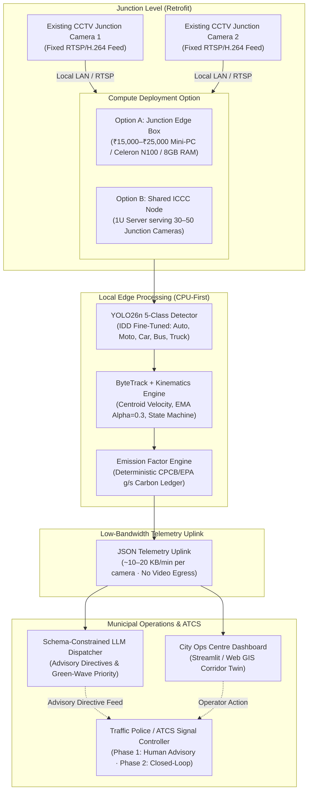
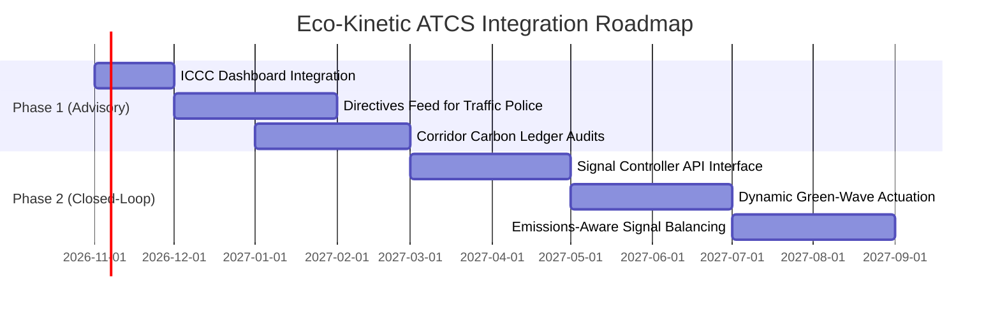

# Deployment Architecture & Government Integration Brief — DRAFT v1

**Project**: Eco-Kinetic Traffic Carbon Digital Twin  
**Target Stakeholder**: Municipal Corporations, Smart City Special Purpose Vehicles (SPVs), Integrated Command and Control Centres (ICCC), and Traffic Police Departments  
**Status**: DRAFT v1 (Confidential / Government Advisory Note)

---

## 1. Executive Summary & Value Proposition

Indian metropolitan areas face simultaneous crises of chronic traffic congestion and severe ambient air degradation. Traditional traffic optimization systems (e.g. legacy fixed-time or basic loop-detector ATCS) evaluate throughput purely in vehicular Passenger Car Units (PCU), ignoring the acute emission penalties associated with stop-and-go acceleration and protracted idling.

The **Eco-Kinetic Traffic Carbon Digital Twin** introduces a **software-only retrofit** that transforms a city’s **existing CCTV camera fleet** into a real-time carbon intelligence and micro-directive platform. By analyzing live vehicle kinematics (IDLE, ACCEL, CRUISE, DECEL) and combining them with calibrated Indian emission matrices, municipal operators can quantify corridor-level emissions in real time and execute emissions-aware traffic management directives without procuring expensive sensor infrastructure.

---

## 2. Deployment Topology

The platform supports two deployment models: **Decentralized Edge Processing** (on-premise mini-PC at the junction) and **Centralized ICCC Compute Pooling** (RTSP streams processed centrally at the municipal data center). In both designs, **video egress is strictly prohibited**—only lightweight, anonymized kinematic telemetry is transmitted over municipal networks.



### Telemetry Payload Schema
Every 30 twin-seconds, each processing node transmits aggregate telemetry over HTTPS/MQTT:
```json
{
  "timestamp": "2026-10-15T14:30:00Z",
  "junction_id": "DELHI-ND-J04",
  "active_vehicles": 18,
  "queue_length_per_lane": {"North": 8, "South": 4, "East": 6, "West": 0},
  "idle_ratio": 0.42,
  "heavy_vehicle_density": 0.16,
  "co2_rate_g_per_min": 1420.5,
  "cumulative_co2_kg": 18.4,
  "top_choke_zone": "approach_north_choke"
}
```

---

## 3. Financial Model: Per-Junction Retrofit Cost

Because the system leverages cameras already installed by police, PWD, or municipal Smart City projects, capital expenditure (CapEx) is limited to commodity edge compute, with zero civil works or road cuts.

| Component | Specification | Unit Cost (INR) | Capital Model | Notes |
| :--- | :--- | :---: | :--- | :--- |
| **Edge Compute Hardware** | Quad-core Mini-PC (Intel N100 / 8GB DDR5 / 128GB SSD) | ₹18,000 | CapEx (One-time) | Replaces expensive GPU servers; processes 2–4 720p streams @ 12.5 FPS |
| **Network & Enclosure** | IP66 weatherized box + PoE injector | ₹4,500 | CapEx (One-time) | Installed in existing junction traffic controller cabinet |
| **Optical Cameras** | Existing City Police / PWD CCTV Cameras | **₹0** | Existing Fleet | 100% software retrofit; no camera procurement needed |
| **Camera Calibration** | 10-minute digital homography & zone polygon mapping | ₹1,500 | One-time Setup | Simple web-based drag-and-drop tool operated by municipal engineer |
| **Telemetry Uplink** | 4G/5G M2M SIM or Municipal Fiber Backbone | ₹350 / mo | OpEx (Recurring) | Minimal bandwidth payload (~15 KB/min = <25 MB/month) |
| **Software License & Maintenance** | Core Python Digital Twin + Cloud Dashboard hosting | ₹2,000 / mo | OpEx (Annualized) | Includes over-the-air model updates and telemetry archiving |
| **Total Year 1 Cost per Junction** | **Fully Installed & Maintained** | **₹50,000** | *(Equivalent to <5% of a single physical inductive loop installation)* |

*Alternative Shared ICCC Model*: A single 32-core server (₹2,50,000) deployed at the ICCC processes 40 RTSP camera streams directly, lowering compute CapEx to ~₹6,250 per junction approach.

---

## 4. Privacy by Architecture (DPDP Act Compliance)

In strict accordance with the **Digital Personal Data Protection (DPDP) Act, 2023** and municipal surveillance governance standards:

1. **Zero Personally Identifiable Information (PII)**:
   - The platform strictly omits Automatic Number Plate Recognition (ANPR) and facial recognition across both video and still image processing modes.
   - Bounding boxes identify only coarse vehicular silhouettes (`car`, `motorcycle`, `auto_rickshaw`, `bus`, `truck`).
2. **Local Video and Photograph Confinement**:
   - Camera video frames and user-uploaded traffic photographs reside in volatile RAM on the local compute node only during inference (lifespan <100ms for video frames; discarded immediately after analysis for uploaded still images).
   - Video buffers and photograph uploads are never written to permanent disk storage, logged, or egressed across network boundaries.
   - Zero transmission of images or frames to external services, commercial cloud vision APIs, or LLM providers.
3. **Pure Kinematic Telemetry & Aggregation**:
   - Upstream communications are restricted to mathematical aggregates (velocity vectors, acceleration state, vehicle counts, carbon grams). No visual reconstructibility is possible from transmitted payloads.
4. **Input Security & Guardrails for Image Uploads**:
   - Allowed formats are strictly restricted to `.jpg`, `.jpeg`, `.png`, and `.webp` with file-size boundaries enforced (max 20 MB).
   - Safe error handling prevents exposing filesystem paths, environment variables, or system secrets in user-facing error messages.

---

## 5. Integration Roadmap: ATCS & ICCC



- **Phase 1 (Immediate / Hackathon Scope) — Human-in-the-Loop Advisory**:
  - The Digital Twin operates in parallel with existing traffic systems (e.g., ITMS, CoSiCoSt, SCATS).
  - The Schema-Constrained LLM Dispatcher generates natural-language recommendations (e.g., *"Extend Phase 2 Green by 8 seconds on North Corridor: clears 6 idling auto-rickshaws, mitigating 185g CO2"*).
  - Directives appear on the Traffic Police duty officer dashboard for voluntary manual execution.
- **Phase 2 (Long-Term Horizon) — Closed-Loop Adaptive Signal Actuation**:
  - Direct integration via NTCIP 1202 or custom vendor APIs into local junction signal master controllers.
  - Signal timing dynamically adjusts green splits to minimize cumulative idling time for heavy commercial and multi-passenger transit corridors.

---

## 6. AI Model Lineage & Deployment Review

- **Model Checkpoint**: Fine-tuned YOLO26n 5-class detector (`models/finetuned/best.pt`, 5.4 MB, FP32).
- **Domain Specialization**: Fine-tuned on the India Driving Dataset (IDD Fine-Grained) to address the endemic failure of stock COCO models in detecting **auto-rickshaws** and three-wheelers (achieving validation **mAP@50 of 0.881** overall and **0.903 for auto-rickshaws**).
- **Deployment Review Flag**:
  - The underlying IDD research dataset was released under an academic/research non-commercial evaluation framework.
  - Prior to municipal commercial deployment or statewide Smart City rollouts, procurement authorities must formalize commercial licensing with data custodians (IIIT-H CVIT) or re-train using city-licensed surveillance calibration frames.

---

## 7. Limitations & Scientific Scope

1. **Indicative vs. Tailpipe-Accurate Carbon Modeling**:
   - Video-derived emissions represent macro-level, kinematics-indexed approximations (modeled after EPA MOVES and CPCB emission factors) rather than tailpipe electrochemical measurements.
   - Factors account for vehicle class, speed proxy, and operating mode (IDLE, ACCEL, CRUISE, DECEL), but do not observe individual engine maintenance conditions, gross polluters, or overloading.
2. **Environmental & Optical Vulnerabilities**:
   - Severe weather conditions (torrential monsoon rainfall, heavy winter photochemical smog, or unlit nighttime conditions) degrade detection recall. When mean frame luma drops below 35, the system automatically tags telemetry with confidence warnings.
3. **Camera Geometry Dependability**:
   - Accuracy depends on fixed camera calibration. If physical camera angle shifts significantly (e.g., due to wind or maintenance), the digital homography profile must be updated via the calibration interface.
